# rag-enterprise-agent

**A retrieval-augmented generation (RAG) knowledge system and tool-calling agent
built from scratch in Python and NumPy** — hybrid retrieval (dense + BM25 +
Reciprocal Rank Fusion), role-based access control, citation validation,
prompt A/B testing, per-query latency metrics, a FastAPI service with SSE
streaming, and a hand-written plan-act-observe agent loop — designed as a
portfolio project for enterprise AI / Copilot engineering roles.

- **No RAG or agent frameworks**: no LangChain, LlamaIndex, Haystack,
  Semantic Kernel or AutoGen. The retrieval core and the agent loop are
  hand-written on NumPy and the standard library.
- **Fully offline by default**: `pytest -q` runs on a laptop CPU with zero
  model downloads (deterministic fakes). The real stack (Ollama + a
  sentence-transformers model) is a flag away.
- **Everything is synthetic**: the six corpus documents describe the invented
  company *Aurora Atlas Events* — no real company data, no real people.
- **Cloud adapters are honest**: the Azure equivalents are interfaced, mocked
  in tests, and labelled **NOT TESTED AGAINST LIVE SERVICE**.

## Architecture

```mermaid
flowchart LR
    subgraph Ingestion
        A[data/docs/*.md<br/>YAML front matter:<br/>title, allowed_roles]
        B[rag/loaders.py<br/>parse front matter, pypdf]
        C[rag/cleaning.py<br/>NFKC, strip repeated headers]
        D[rag/chunking.py<br/>fixed / sentence-aware,<br/>overlap, stable chunk ids]
        E[rag/embedder.py<br/>BGE-small or FakeEmbedder<br/>L2-normalised]
        F[rag/vector_store.py<br/>NumPy matrix + BM25 index]
        A --> B --> C --> D --> E --> F
    end
    subgraph Ask pipeline
        Q([question + user_role])
        S[rag/security.py<br/>role allow-set, injection scan,<br/>PII redaction, length cap]
        R[rag/hybrid.py<br/>dense + BM25 -> RRF fusion]
        RR[rag/reranker.py<br/>optional cross-encoder]
        P[rag/prompt.py<br/>versioned template + token budget]
        G[rag/generator.py<br/>Ollama / OpenAI-compat / Azure / Fake]
        V[citation validation<br/>against context ids]
        OUT([answer + sources + timings])
        Q --> S --> R --> RR --> P --> G --> V --> OUT
    end
    F --> R
    subgraph Serving
        M[api/main.py FastAPI<br/>/ask SSE, /ask_sync, /ingest,<br/>/feedback, /metrics, /health]
        UI[ui/index.html<br/>single-file SSE client]
        L[observability/<br/>JSON logs + SQLite query_log<br/>questions hashed]
        AG[agent/loop.py plan-act-observe<br/>tools.py allowlist + confirm]
        M --> L
        UI --> M
        AG --> R
        M --> AG
    end
    subgraph Evaluation
        EV[data/eval/eval_set.jsonl<br/>50 items: 30/8/6/6]
        RUN[rag/evaluation/run_eval.py<br/>chunk sizes x modes]
        AB[prompt_ab.py v1/v2/v3]
        RUN --> EV
        AB --> EV
    end
    F -. azure_adapters/<br/>AI Search / Graph / Teams .-> M
```



## Setup in 5 commands

```bash
git clone <your-fork-url> && cd rag-enterprise-agent
python -m venv .venv && source .venv/bin/activate
pip install -r requirements-dev.txt      # torch is heavy: see requirements.txt CPU note
cp .env.example .env                     # optional: all values have safe dummies
pytest -q                                # 218 passed, 1 deselected (offline)
```

`pytest -q` deselects the integration marker (the one test that downloads
the real embedding model). Run everything with `pytest -q -m integration`.
After a clean install, lock your environment with
`pip freeze > requirements.lock.txt` and commit it.

## Running everything

Everything below works **offline** with `--fake`; drop the flag (and set
`LLM_PROVIDER` in `.env`) for the real stack: Ollama by default
(`OLLAMA_MODEL=qwen2.5:3b`), any OpenAI-compatible endpoint, or Azure OpenAI.

```bash
make ingest            # or: python scripts/ingest.py --fake
make ask Q="What is the refund rule for event cancellation?"
make serve             # uvicorn api.main:app -> http://localhost:8000  (UI at /)
make eval              # chunk sizes 256/512/768 x 4 modes -> eval_out/results.{csv,md}
make prompt-ab         # prompts v1/v2/v3 on the same eval set -> eval_out/prompt_ab.md
make agent-demo        # refund use case: answer-with-citations OR ticket + Teams escalation
make benchmark         # IVF vs brute-force: recall@10 and latency table
make openapi           # openapi.json for the Copilot Studio custom connector
make docker-build      # multi-stage, non-root, healthcheck (never baked secrets)
```

Numbers printed by `eval`, `prompt-ab` and `benchmark` are **measurements
from this run on this machine — approximate**, and fake-mode runs are harness
smoke tests, not quality results. See RESUME_KIT.md before quoting any number.

## The 2-minute demo script

1. `pytest -q` — show the offline suite passing (point out the fakes).
2. `make ingest && make ask` — grounded answer with chunk-level sources and
   timings; then ask a guest-role HR question and show the refusal.
3. `make serve`, open the UI at `/`, ask "What is the refund rule for event
   cancellation?", stream the answer, show sources, click a thumbs button.
4. `curl -N -X POST localhost:8000/ask -H 'X-API-Key: ...' -H 'Content-Type:
   application/json' -d '{"question":"..."}'` — show the SSE event order:
   `sources`, many `token`, `done`.
5. `make agent-demo` — scenario B shows the agent opening a CRM ticket and
   posting to `#support-escalations` when the KB has no answer.
6. `cat eval_out/results.md` — the sweep table; explain chunk-size trade-offs.

## What is built by hand vs pre-trained

| Component | Status | Where |
|---|---|---|
| Chunking (fixed + sentence-aware, overlap) | hand-written | `rag/chunking.py` |
| Text cleaning (NFKC, header stripping, tokeniser) | hand-written | `rag/cleaning.py` |
| Vector store (dot=cosine, ACL before ranking, IVF k-means) | hand-written | `rag/vector_store.py` |
| BM25 (Okapi, inverted index, IDF) | hand-written | `rag/bm25.py` |
| Hybrid fusion (RRF, min-max) | hand-written | `rag/hybrid.py` |
| Cross-encoder reranking | pre-trained model behind hand-written flag | `rag/reranker.py` |
| MMR diversification | hand-written | `rag/mmr.py` |
| Prompts v1/v2/v3 + token budgeting | hand-written | `prompts/`, `rag/prompt.py` |
| Citation extraction + validation | hand-written | `rag/generator.py` |
| Role ACL, PII redaction, injection heuristics | hand-written | `rag/security.py` |
| Agent loop (plan-act-observe, allowlist, confirm) | hand-written | `agent/loop.py`, `agent/tools.py` |
| Eval metrics (recall/MRR/nDCG/groundedness/...) | hand-written | `rag/evaluation/metrics.py` |
| Embedding model (BAAI/bge-small-en-v1.5) | **pre-trained** (allowed) | via `sentence-transformers` |
| Generation LLM (qwen2.5:3b / Azure OpenAI / ...) | **pre-trained** (allowed) | `rag/generator.py` |
| FastAPI service + SSE + UI | hand-written (frameworks: FastAPI only) | `api/`, `ui/` |

## What is mocked vs live

| Component | Mode | Notes |
|---|---|---|
| Embedder / LLM in tests and `--fake` runs | mocked (`FakeEmbedder`, `FakeLLM`) | deterministic, offline |
| Agent demo LLM | mocked (`DemoFakeLLM`, scripted policy) | `--live` uses your configured provider |
| CRM tickets | mocked (`agent/crm_mock.py`, SQLite) | production: Dynamics 365 via connector |
| Teams posts | mocked (`agent/teams_mock.py`, log file) | production: `azure_adapters/teams_webhook.py` |
| API auth | demo API key (constant-time) | production: Entra ID token claims |
| Metrics store | live SQLite (`logs/metrics.db`) | questions stored hashed only |
| Azure OpenAI / AI Search / Graph / Teams | interface + mocks only | **NOT TESTED AGAINST LIVE SERVICE** |
| Ollama / OpenAI-compat providers | live HTTP (when configured) | retries, backoff, streaming |
| Copilot Studio / Power Platform | guide only, no running code | `COPILOT_STUDIO_GUIDE.md` |

## Troubleshooting

| Symptom | Likely cause | Fix |
|---|---|---|
| `pytest` fails importing `rag` | not run from repo root / venv not active | `cd rag-enterprise-agent`, `source .venv/bin/activate` |
| `sentence_transformers` / `torch` install is huge | default PyPI torch pulls CUDA | `pip install torch --index-url https://download.pytorch.org/whl/cpu` first |
| First real ingest hangs/downloads | BGE model downloading on first use | wait once (cached in `cache/embeddings`), or use `--fake` |
| `RuntimeError: LLM call failed ... ConnectError` | Ollama not running | `ollama serve` and `ollama pull qwen2.5:3b` |
| `make ask` says "index not built" | ingest never ran | `make ingest` (or `python scripts/ingest.py --fake`) |
| Every question returns the refusal | `no_answer_threshold` too high for your embedder | real BGE: keep 0.35; if you switch models, re-calibrate via `run_eval` |
| `POST /ask` returns 503 index not built | service started before ingest | run `make ingest`, or POST `/ingest` |
| `401 invalid or missing X-API-Key` | `API_KEY` set but header missing | send `X-API-Key` from `.env`; empty `API_KEY` disables auth (dev only) |
| SSE answers arrive all at once | a buffering proxy in front of uvicorn | disable proxy buffering (`X-Accel-Buffering: no` is already set) |
| `/feedback` returns 404 | request_id never logged as a query | only answers issued after the service started have ids |
| Docker image > 3 GB | torch wheel included | expected with the full requirements; slim it by trimming heavy deps in a separate requirements file |
| GitHub CI is slow at pip install | torch chain | expected; the pinned set installs in one pass, cache is enabled |

## Limitations (honest list)

- The corpus is six small synthetic documents; retrieval quality conclusions
  do not transfer to a production corpus without re-running the eval.
- BM25 has no stemming ("refund" ≠ "refunds"); the dense half of hybrid
  retrieval covers most of that gap.
- Security heuristics (PII regexes, injection phrase lists) are documented
  as incomplete; they are a first layer, not a defence.
- Fake-mode eval numbers are harness checks only; measure with the real
  model before claiming anything.
- The agent's live mode depends entirely on the model following the JSON
  protocol; the loop bounds the damage (allowlist, confirm gate, step limit)
  but cannot make a weak model smart.
- MMR and IVF are tested components used by `scripts/benchmark.py`; the
  serving path uses brute-force search (honest at this corpus size).
- Azure adapters: interfaces + mocks only. Nothing here was deployed.

## What each directory is

```
data/docs/      synthetic corpus (6 markdown files, YAML front matter roles)
data/eval/      50-item eval set (30 in-scope / 8 out-of-scope / 6 injection / 6 access-control)
prompts/        prompt_v1/v2/v3 templates (v3 = grounding + injection defence)
rag/            retrieval core: config, loaders, cleaning, chunking, embedder,
                vector_store (+IVF), bm25, hybrid (RRF), reranker, mmr,
                prompt, generator, security, pipeline
rag/evaluation/ metrics, sweep runner, prompt A/B
agent/          tool registry (allowlist + confirm), crm/teams mocks, loop
observability/  JSON logging + SQLite query metrics (hashed questions)
api/            FastAPI service (SSE /ask, /ask_sync, /ingest, /feedback, /metrics)
ui/             single-file web client (no CDN, responsive)
azure_adapters/ cloud bridges (NOT TESTED AGAINST LIVE SERVICE) + README_AZURE.md
sql/            schema + 6 analytics queries for the metrics table
scripts/        ingest, ask, benchmark, export_openapi, run_agent_demo,
                validate_eval_set
tests/          one test module per module + fakes.py (219 tests: 218 passed
                + 1 integration deselected; fully offline)
```

Further reading: `INTERVIEW_NOTES.md` (study guide), `JD_MAPPING.md` (JD ->
evidence), `COPILOT_STUDIO_GUIDE.md` (connector walkthrough),
`RESUME_KIT.md` (bullets with [MEASURED] placeholders), `PROGRESS.md`
(build log).
